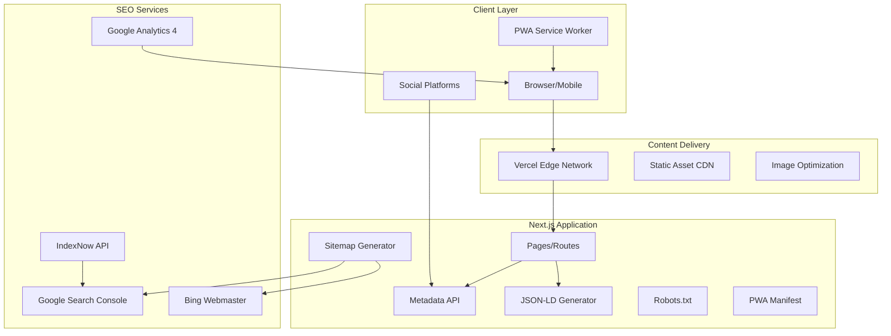
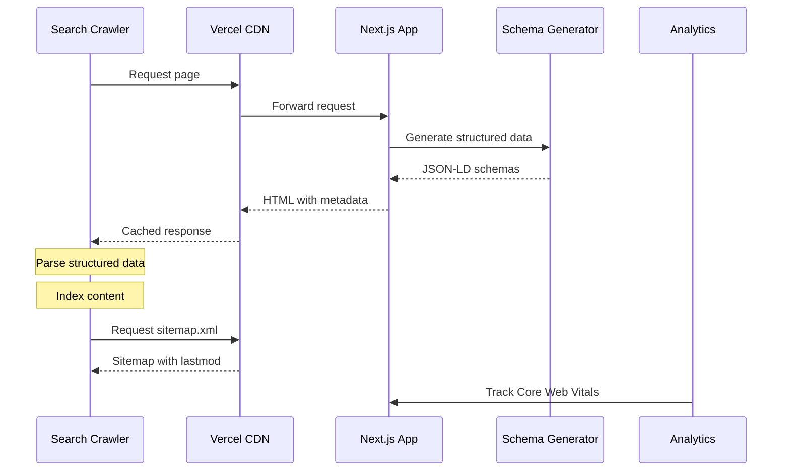

# Design Document: SEO Traffic Enhancement

## Overview

This design document outlines the technical implementation for maximizing organic traffic to the Mahdi Ben Rhouma portfolio website (mahdibr.online). The solution focuses on comprehensive SEO optimization across search engines, social platforms, developer communities, and professional networks to attract recruiters, hiring managers, and potential clients seeking a full-stack developer.

The implementation leverages Next.js 14+ built-in SEO capabilities, structured data schemas, performance optimization techniques, and multi-platform integration to achieve maximum visibility across all traffic sources.

## Architecture

### High-Level Architecture



### SEO Data Flow



## Components and Interfaces

### 1. Metadata Configuration Module

**Location:** `app/layout.tsx`, `lib/seo/metadata.ts`

```typescript
// lib/seo/metadata.ts
interface SEOConfig {
  baseUrl: string;
  siteName: string;
  defaultTitle: string;
  defaultDescription: string;
  author: AuthorInfo;
  social: SocialProfiles;
  languages: SupportedLanguage[];
  geo: GeoTargeting;
}

interface AuthorInfo {
  name: string;
  jobTitle: string;
  email: string;
  image: string;
  alumniOf: EducationInfo;
}

interface SocialProfiles {
  github: string;
  linkedin: string;
  twitter?: string;
  stackoverflow?: string;
}

interface SupportedLanguage {
  code: string;      // 'en', 'fr', 'ar'
  locale: string;    // 'en_US', 'fr_FR', 'ar_TN'
  name: string;
  hreflang: string;
}

interface GeoTargeting {
  primaryRegion: string;
  targetRegions: string[];
  timezone: string;
}

// Metadata generator function
function generateMetadata(page: PageConfig, locale: string): Metadata;
function generateOpenGraph(page: PageConfig, locale: string): OpenGraph;
function generateTwitterCard(page: PageConfig): TwitterCard;
```

### 2. Structured Data Generator

**Location:** `lib/seo/structured-data.ts`

```typescript
// lib/seo/structured-data.ts
interface StructuredDataGenerator {
  generatePersonSchema(): PersonSchema;
  generateProfilePageSchema(): ProfilePageSchema;
  generateCreativeWorkSchema(project: Project): CreativeWorkSchema;
  generateItemListSchema(skills: Skill[]): ItemListSchema;
  generateFAQSchema(faqs: FAQ[]): FAQPageSchema;
  generateBreadcrumbSchema(path: string[]): BreadcrumbListSchema;
  generateEducationSchema(education: Education): EducationalCredentialSchema;
  generateSoftwareSchema(repo: Repository): SoftwareSourceCodeSchema;
}

// Schema types following Schema.org specifications
interface PersonSchema {
  "@context": "https://schema.org";
  "@type": "Person";
  name: string;
  jobTitle: string;
  description: string;
  url: string;
  email: string;
  image: string;
  alumniOf: EducationalOrganization;
  knowsAbout: string[];
  sameAs: string[];
  address?: PostalAddress;
  workLocation?: Place;
}

interface CreativeWorkSchema {
  "@context": "https://schema.org";
  "@type": "CreativeWork" | "SoftwareApplication";
  name: string;
  description: string;
  creator: PersonReference;
  dateCreated: string;
  programmingLanguage?: string[];
  applicationCategory?: string;
  url?: string;
}
```

### 3. Multi-language SEO Module

**Location:** `lib/seo/i18n-seo.ts`

```typescript
// lib/seo/i18n-seo.ts
interface I18nSEOConfig {
  defaultLocale: string;
  locales: LocaleConfig[];
  translations: Record<string, TranslationSet>;
}

interface LocaleConfig {
  code: string;
  hreflang: string;
  direction: 'ltr' | 'rtl';
  regions: string[];
}

interface TranslationSet {
  meta: {
    title: string;
    description: string;
    keywords: string[];
  };
  content: Record<string, string>;
}

function generateHreflangTags(currentLocale: string, path: string): HreflangTag[];
function generateLocalizedSitemap(locales: string[]): SitemapEntry[];
function getLocalizedMetadata(locale: string, page: string): LocalizedMetadata;
```

### 4. Performance Optimization Module

**Location:** `lib/seo/performance.ts`

```typescript
// lib/seo/performance.ts
interface PerformanceConfig {
  images: ImageOptimizationConfig;
  fonts: FontOptimizationConfig;
  scripts: ScriptOptimizationConfig;
  caching: CachingConfig;
}

interface ImageOptimizationConfig {
  formats: ('webp' | 'avif')[];
  sizes: ResponsiveSizes;
  lazyLoadThreshold: number;
  placeholderType: 'blur' | 'empty' | 'color';
}

interface FontOptimizationConfig {
  preloadFonts: string[];
  fontDisplay: 'swap' | 'optional' | 'fallback';
  subsets: string[];
}

interface CoreWebVitalsTargets {
  lcp: number;  // < 2500ms
  cls: number;  // < 0.1
  inp: number;  // < 200ms
  fcp: number;  // < 1800ms
  ttfb: number; // < 800ms
}
```

### 5. Analytics and Tracking Module

**Location:** `lib/seo/analytics.ts`

```typescript
// lib/seo/analytics.ts
interface AnalyticsConfig {
  googleAnalyticsId: string;
  googleSearchConsoleId: string;
  bingWebmasterKey: string;
  vercelAnalytics: boolean;
}

interface TrackingEvents {
  pageView(page: string, locale: string): void;
  contactClick(method: 'email' | 'linkedin' | 'github'): void;
  projectView(projectId: string): void;
  skillInteraction(skill: string): void;
  scrollDepth(percentage: number): void;
  timeOnPage(seconds: number): void;
}

interface WebVitalsReporter {
  reportLCP(value: number): void;
  reportCLS(value: number): void;
  reportINP(value: number): void;
  reportFCP(value: number): void;
  reportTTFB(value: number): void;
}
```

### 6. Social Sharing Module

**Location:** `lib/seo/social.ts`

```typescript
// lib/seo/social.ts
interface SocialSharingConfig {
  ogImage: OGImageConfig;
  twitterCard: TwitterCardConfig;
  linkedInPreview: LinkedInConfig;
}

interface OGImageConfig {
  width: 1200;
  height: 630;
  maxFileSize: 300000; // 300KB
  template: 'default' | 'project' | 'blog';
}

interface TwitterCardConfig {
  cardType: 'summary_large_image';
  site: string;
  creator: string;
}

// Dynamic OG image generation
function generateOGImage(config: OGImageParams): Promise<Buffer>;
function validateOGImage(image: Buffer): ValidationResult;
```

### 7. Sitemap and Robots Module

**Location:** `app/sitemap.ts`, `app/robots.ts`

```typescript
// Types for sitemap generation
interface SitemapEntry {
  url: string;
  lastModified: Date;
  changeFrequency: 'always' | 'hourly' | 'daily' | 'weekly' | 'monthly' | 'yearly' | 'never';
  priority: number;
  alternates?: {
    languages: Record<string, string>;
  };
}

interface RobotsConfig {
  rules: RobotsRule[];
  sitemap: string;
  host: string;
}

interface RobotsRule {
  userAgent: string | string[];
  allow?: string[];
  disallow?: string[];
  crawlDelay?: number;
}
```

### 8. PWA and Mobile Module

**Location:** `app/manifest.ts`, `lib/seo/pwa.ts`

```typescript
// app/manifest.ts
interface WebAppManifest {
  name: string;
  short_name: string;
  description: string;
  start_url: string;
  display: 'standalone' | 'fullscreen' | 'minimal-ui' | 'browser';
  background_color: string;
  theme_color: string;
  icons: ManifestIcon[];
  categories: string[];
  lang: string;
  dir: 'ltr' | 'rtl';
}

interface ManifestIcon {
  src: string;
  sizes: string;
  type: string;
  purpose?: 'any' | 'maskable' | 'monochrome';
}
```

## Data Models

### SEO Configuration Data Model

```typescript
// Central SEO configuration
const seoConfig: SEOConfig = {
  baseUrl: 'https://mahdibr.online',
  siteName: 'Mahdi Ben Rhouma Portfolio',
  defaultTitle: 'Mahdi Ben Rhouma - Full-Stack Developer',
  defaultDescription: 'Full-stack developer specializing in React, Next.js, FastAPI, and Spring Boot',
  author: {
    name: 'Mahdi Ben Rhouma',
    jobTitle: 'Full-Stack Developer',
    email: 'mahdi.benrhouma@sesame.com.tn',
    image: '/images/profile.jpg',
    alumniOf: {
      name: 'Sesame University',
      degree: 'LIM3 - License in Multimedia Informatics',
      field: 'Web Development'
    }
  },
  social: {
    github: 'https://github.com/mahdibrr',
    linkedin: 'https://www.linkedin.com/in/mahdi-ben-rhouma-180971357/',
    stackoverflow: undefined
  },
  languages: [
    { code: 'en', locale: 'en_US', name: 'English', hreflang: 'en' },
    { code: 'fr', locale: 'fr_FR', name: 'Français', hreflang: 'fr' },
    { code: 'ar', locale: 'ar_TN', name: 'العربية', hreflang: 'ar' }
  ],
  geo: {
    primaryRegion: 'TN',
    targetRegions: ['TN', 'FR', 'BE', 'CH', 'CA', 'AE', 'SA'],
    timezone: 'Africa/Tunis'
  }
};
```

### Project Data Model for SEO

```typescript
interface ProjectSEO {
  id: string;
  slug: string;
  title: Record<string, string>;  // Localized titles
  description: Record<string, string>;  // Localized descriptions
  technologies: string[];
  category: 'web' | 'mobile' | 'backend' | 'fullstack';
  dateCreated: string;
  dateModified: string;
  images: ProjectImage[];
  url?: string;
  repository?: string;
  keywords: string[];
}

interface ProjectImage {
  src: string;
  alt: Record<string, string>;  // Localized alt text
  width: number;
  height: number;
}
```

### Skills Data Model for SEO

```typescript
interface SkillCategory {
  id: string;
  name: Record<string, string>;
  skills: Skill[];
}

interface Skill {
  name: string;
  aliases: string[];  // Alternative names for SEO
  proficiency: number;  // 0-100
  yearsExperience: number;
  keywords: string[];
}
```


## Correctness Properties

*A property is a characteristic or behavior that should hold true across all valid executions of a system-essentially, a formal statement about what the system should do. Properties serve as the bridge between human-readable specifications and machine-verifiable correctness guarantees.*

Based on the acceptance criteria analysis, the following correctness properties have been identified for property-based testing:

### Property 1: Schema Generation Validity

*For any* valid SEO configuration and content data, the generated JSON-LD schemas SHALL be valid according to Schema.org specifications and contain all required fields for their respective types (Person, ProfilePage, CreativeWork, ItemList, ContactPoint, EducationalOccupationalCredential, SoftwareSourceCode).

**Validates: Requirements 1.1, 1.2, 1.3, 1.4, 1.5, 1.6, 1.7, 1.8**

### Property 2: Social Metadata Completeness

*For any* page configuration and locale, the generated Open Graph and Twitter Card metadata SHALL include all required attributes (og:title, og:description, og:image, og:url, og:type, og:site_name, og:locale, twitter:card, twitter:title, twitter:description, twitter:image) with valid values.

**Validates: Requirements 2.1, 2.2, 2.3, 2.5, 2.6**

### Property 3: OG Image Size Constraint

*For any* generated Open Graph image, the file size SHALL be less than or equal to 300KB while maintaining dimensions of 1200x630 pixels.

**Validates: Requirements 2.5**

### Property 4: Multi-language SEO Completeness

*For any* page supporting multiple languages, the generated HTML SHALL include valid hreflang tags for all supported locales, and the HTML lang attribute SHALL match the current locale.

**Validates: Requirements 3.1, 3.2, 3.3**

### Property 5: Sitemap Alternate URLs

*For any* page with multiple language versions, the generated sitemap SHALL include alternate language URLs with correct hreflang annotations for each supported locale.

**Validates: Requirements 3.4**

### Property 6: Image Optimization Attributes

*For any* image element in the rendered output, the element SHALL include srcset attribute with multiple sizes and appropriate format (WebP/AVIF) when supported.

**Validates: Requirements 4.4**

### Property 7: Sitemap Entry Integrity

*For any* content page with a modification date, the generated sitemap entry SHALL include a lastmod date that reflects the actual content modification date, and priority SHALL be a valid value between 0.0 and 1.0.

**Validates: Requirements 5.1, 13.1**

### Property 8: Canonical URL Self-Reference

*For any* page URL, the canonical link tag SHALL contain a URL that matches the page's canonical URL (self-referencing).

**Validates: Requirements 5.3**

### Property 9: Heading Hierarchy Validity

*For any* rendered page content, the heading elements (h1-h6) SHALL follow a valid hierarchy where no heading level is skipped (e.g., h1 followed by h3 without h2 is invalid).

**Validates: Requirements 6.1**

### Property 10: Image Alt Text Presence

*For any* image element in the rendered output, the alt attribute SHALL be present and contain non-empty descriptive text.

**Validates: Requirements 6.2**

### Property 11: Anchor Text Quality

*For any* internal link element, the anchor text SHALL NOT be a generic phrase (e.g., "click here", "read more", "link") and SHALL contain descriptive text.

**Validates: Requirements 6.3**

### Property 12: Page Title Format

*For any* page, the title tag SHALL follow the format pattern containing the page name, separator, and site name, with total length between 30-60 characters.

**Validates: Requirements 6.4**

### Property 13: Meta Description Length

*For any* page, the meta description SHALL contain between 150-160 characters and include at least one primary keyword.

**Validates: Requirements 6.5**

### Property 14: FAQ Schema Structure

*For any* FAQ content data, the generated FAQPage schema SHALL contain valid Question and Answer pairs with non-empty text content.

**Validates: Requirements 11.1**

### Property 15: PWA Manifest Validity

*For any* PWA manifest configuration, the generated manifest.json SHALL include all required fields (name, short_name, start_url, display, icons) with valid values, and icons SHALL include at least 192x192 and 512x512 sizes.

**Validates: Requirements 12.2**

### Property 16: Accessibility ARIA Labels

*For any* interactive element (buttons, links, form inputs), the element SHALL have either visible text content, an aria-label, or an aria-labelledby reference.

**Validates: Requirements 15.1, 15.4**

## Error Handling

### Schema Generation Errors

| Error Type | Handling Strategy | User Impact |
|------------|-------------------|-------------|
| Invalid schema data | Log error, use fallback minimal schema | Reduced rich snippets |
| Missing required fields | Use default values from config | Partial schema output |
| Schema validation failure | Log warning, output schema anyway | May not pass Google validation |

### Metadata Generation Errors

| Error Type | Handling Strategy | User Impact |
|------------|-------------------|-------------|
| Missing translation | Fall back to default locale | English content shown |
| Invalid image path | Use placeholder OG image | Generic social preview |
| Locale not supported | Default to 'en' | English metadata |

### Performance Optimization Errors

| Error Type | Handling Strategy | User Impact |
|------------|-------------------|-------------|
| Image optimization failure | Serve original image | Larger file size |
| Font loading failure | Use system font fallback | Different typography |
| Service worker error | Disable PWA features | No offline support |

### Analytics Errors

| Error Type | Handling Strategy | User Impact |
|------------|-------------------|-------------|
| Analytics script blocked | Graceful degradation | No tracking data |
| Web Vitals API unavailable | Skip reporting | No performance metrics |
| Network error | Queue events for retry | Delayed reporting |

## Testing Strategy

### Dual Testing Approach

This implementation uses both unit testing and property-based testing to ensure comprehensive coverage:

- **Unit tests** verify specific examples, edge cases, and integration points
- **Property-based tests** verify universal properties that should hold across all valid inputs

### Testing Framework

- **Unit Testing**: Vitest (compatible with Next.js)
- **Property-Based Testing**: fast-check (JavaScript PBT library)
- **E2E Testing**: Playwright (for Core Web Vitals and rendering)

### Property-Based Testing Configuration

```typescript
// vitest.config.ts
import { defineConfig } from 'vitest/config';

export default defineConfig({
  test: {
    include: ['**/*.test.ts', '**/*.property.test.ts'],
    coverage: {
      reporter: ['text', 'json', 'html'],
    },
  },
});
```

### Test Categories

#### 1. Schema Generation Tests (Property-Based)

```typescript
// lib/seo/__tests__/structured-data.property.test.ts
import * as fc from 'fast-check';
import { generatePersonSchema, generateCreativeWorkSchema } from '../structured-data';

// Property 1: Schema Generation Validity
describe('Schema Generation', () => {
  it('generates valid Person schema for any valid config', () => {
    fc.assert(
      fc.property(
        fc.record({
          name: fc.string({ minLength: 1 }),
          jobTitle: fc.string({ minLength: 1 }),
          email: fc.emailAddress(),
          // ... other fields
        }),
        (config) => {
          const schema = generatePersonSchema(config);
          expect(schema['@context']).toBe('https://schema.org');
          expect(schema['@type']).toBe('Person');
          expect(schema.name).toBeTruthy();
          expect(schema.jobTitle).toBeTruthy();
        }
      ),
      { numRuns: 100 }
    );
  });
});
```

#### 2. Metadata Tests (Property-Based)

```typescript
// lib/seo/__tests__/metadata.property.test.ts
import * as fc from 'fast-check';

// Property 2: Social Metadata Completeness
describe('Social Metadata', () => {
  it('includes all required OG attributes for any page', () => {
    fc.assert(
      fc.property(
        pageConfigArbitrary,
        localeArbitrary,
        (pageConfig, locale) => {
          const metadata = generateOpenGraph(pageConfig, locale);
          expect(metadata.title).toBeTruthy();
          expect(metadata.description).toBeTruthy();
          expect(metadata.images).toHaveLength(1);
          expect(metadata.url).toMatch(/^https:\/\//);
        }
      ),
      { numRuns: 100 }
    );
  });
});
```

#### 3. Content Validation Tests (Property-Based)

```typescript
// lib/seo/__tests__/content.property.test.ts
import * as fc from 'fast-check';

// Property 13: Meta Description Length
describe('Meta Description', () => {
  it('generates descriptions within 150-160 characters', () => {
    fc.assert(
      fc.property(
        pageContentArbitrary,
        (content) => {
          const description = generateMetaDescription(content);
          expect(description.length).toBeGreaterThanOrEqual(150);
          expect(description.length).toBeLessThanOrEqual(160);
        }
      ),
      { numRuns: 100 }
    );
  });
});
```

#### 4. Unit Tests

```typescript
// lib/seo/__tests__/sitemap.test.ts
describe('Sitemap Generation', () => {
  it('includes lastmod for pages with dates', () => {
    const pages = [{ url: '/projects/test', lastModified: new Date() }];
    const sitemap = generateSitemap(pages);
    expect(sitemap[0].lastModified).toBeDefined();
  });

  it('includes hreflang alternates for multi-language pages', () => {
    const sitemap = generateLocalizedSitemap(['en', 'fr']);
    expect(sitemap[0].alternates?.languages).toHaveProperty('en');
    expect(sitemap[0].alternates?.languages).toHaveProperty('fr');
  });
});
```

#### 5. Accessibility Tests

```typescript
// lib/seo/__tests__/accessibility.property.test.ts
import * as fc from 'fast-check';

// Property 16: Accessibility ARIA Labels
describe('Accessibility', () => {
  it('all interactive elements have accessible names', () => {
    fc.assert(
      fc.property(
        interactiveElementArbitrary,
        (element) => {
          const hasAccessibleName = 
            element.textContent ||
            element.ariaLabel ||
            element.ariaLabelledBy;
          expect(hasAccessibleName).toBeTruthy();
        }
      ),
      { numRuns: 100 }
    );
  });
});
```

### Test File Structure

```
lib/seo/
├── __tests__/
│   ├── structured-data.test.ts          # Unit tests
│   ├── structured-data.property.test.ts # Property tests
│   ├── metadata.test.ts                 # Unit tests
│   ├── metadata.property.test.ts        # Property tests
│   ├── sitemap.test.ts                  # Unit tests
│   ├── sitemap.property.test.ts         # Property tests
│   ├── content.property.test.ts         # Property tests
│   ├── accessibility.property.test.ts   # Property tests
│   └── arbitraries.ts                   # Shared test generators
├── structured-data.ts
├── metadata.ts
├── i18n-seo.ts
├── performance.ts
├── analytics.ts
├── social.ts
└── pwa.ts
```

### E2E Testing for Core Web Vitals

```typescript
// tests/e2e/web-vitals.spec.ts
import { test, expect } from '@playwright/test';

test('Core Web Vitals meet targets', async ({ page }) => {
  await page.goto('/');
  
  const metrics = await page.evaluate(() => {
    return new Promise((resolve) => {
      new PerformanceObserver((list) => {
        const entries = list.getEntries();
        resolve({
          lcp: entries.find(e => e.entryType === 'largest-contentful-paint')?.startTime,
          cls: entries.find(e => e.entryType === 'layout-shift')?.value,
        });
      }).observe({ entryTypes: ['largest-contentful-paint', 'layout-shift'] });
    });
  });
  
  expect(metrics.lcp).toBeLessThan(2500);
  expect(metrics.cls).toBeLessThan(0.1);
});
```

### Validation Testing

```typescript
// tests/validation/schema.test.ts
describe('Schema.org Validation', () => {
  it('Person schema passes validation', async () => {
    const schema = generatePersonSchema(testConfig);
    const result = await validateSchema(schema);
    expect(result.errors).toHaveLength(0);
  });
});
```

